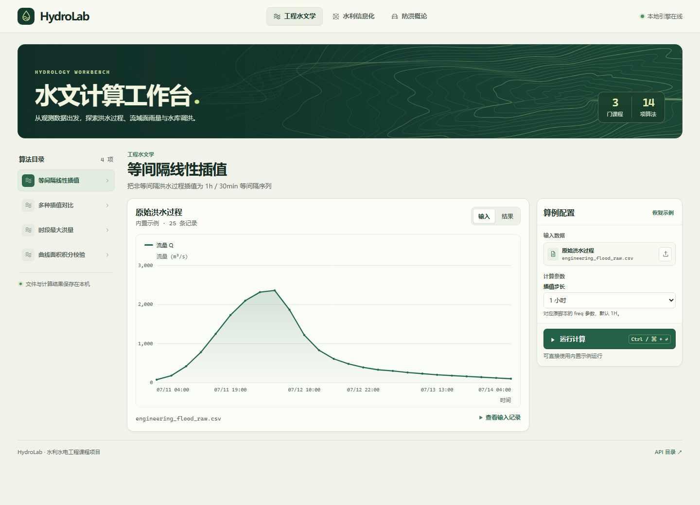
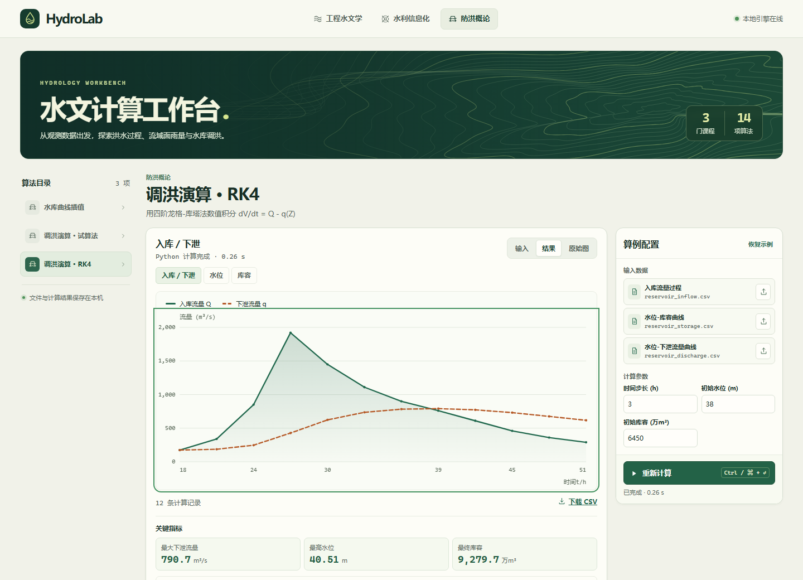
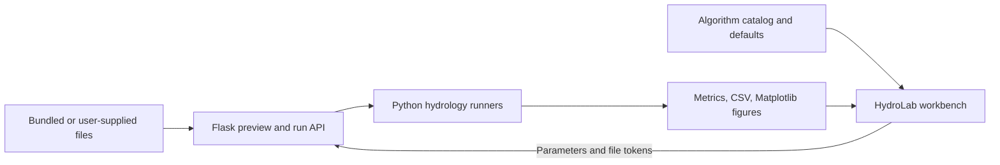

# HydroLab · Hydrology Workbench

[简体中文](README.md) · [Quick start](#quick-start) · [Implementation](#implementation) · [MIT license](LICENSE)

HydroLab is a local workbench for civil and hydraulic engineering coursework. It turns flood hydrographs, basin rainfall estimates, and reservoir routing exercises into a workflow you can explore with bundled datasets and export as CSV.



## Demo

The recording follows a real session. It runs an interpolation comparison, switches to RK4 reservoir routing, inspects inflow, outflow, and reservoir level, then opens the result downloads.


## Quick start

Use **Python 3.10–3.13**. The first dependency installation needs an internet connection. Flask serves the frontend and runs the calculations locally.

| Platform | Run from the repository root |
| --- | --- |
| Windows PowerShell | `.\start_workbench.bat`, or double-click the file |
| macOS / Linux | `bash start_workbench.sh` |

To start in an existing virtual environment, run the following.

```bash
python -m pip install -r requirements.txt
python workbench/start.py
```

Open [http://127.0.0.1:8765](http://127.0.0.1:8765). Press `Ctrl+C` in the terminal to stop the server. Use `python workbench/start.py --port 8766` to change the port, or add `--no-browser` to skip opening a browser automatically.

## From input to results

The workbench interface is in Simplified Chinese.

1. Choose a course and then an algorithm. All 14 algorithms ship with runnable examples.
2. Use a file name in the configuration card or the input switches above the plot to inspect the data. Upload or drop your own CSV files. The Thiessen workflow takes separate Shapefile ZIPs for the basin boundary and rain gauges.
3. Set the parameters and select **运行计算** (Run), or press `Ctrl/⌘ + Enter`. Toggle a series in the legend. Hover over the plot or focus it and use the arrow keys to inspect values.
4. Open **原始图** (Original figure) for the Python-generated analysis figure, or **结果数据与下载** (Result data and downloads) to inspect rows and export CSV. Each table preview shows up to six rows.

| Course | Methods |
| --- | --- |
| Engineering hydrology | Regular-interval linear interpolation, interpolation comparison, maximum flood volume by duration, integration check |
| Water resources informatics | Thiessen areal rainfall, Muskingum X/K calibration and downstream routing, Nash instantaneous and duration unit hydrographs, Sherman unit hydrograph derivation and outlet discharge |
| Introduction to flood control | Reservoir curve interpolation, trial-and-error routing, fourth-order Runge–Kutta (RK4) routing |

<details>
<summary>View screenshots of reservoir routing and areal rainfall</summary>




</details>

## Implementation

Flask supplies the algorithm catalog, form fields, defaults, and bundled samples. A run sends parameters and file tokens to the corresponding Python runner, which returns a summary and links to its CSV and Matplotlib artifacts. The browser renders hydrographs and flood-volume comparisons using Canvas. Reservoir variables with different units have separate views. For spatial analysis, GeoPandas, Shapely, and SciPy produce the basin analysis and the workbench displays the original Thiessen map.



Input plots use the API preview and label truncated data. Result plots use the full result CSV when available. Each export comes from the same Python run. The frontend handles presentation, and the Python scripts and runners handle the numerical work.

The legacy interpolation CSV stores whole hours. With a 30-minute step, the interactive chart follows record order and the original calculation figure shows the exact timestamps.

### Repository layout

```text
.
├── workbench/
│   ├── static/                  # HTML, CSS, workspace interaction, Canvas charts
│   ├── app.py                   # Flask API, previews, and algorithm dispatch
│   ├── catalog.py               # Courses, algorithms, fields, and sample configuration
│   ├── common.py                # Data I/O, Matplotlib theme, and run outputs
│   ├── engineering.py           # Interpolation and flood-volume integration
│   ├── muskingum.py             # Muskingum calibration and routing
│   ├── unit_hydrograph.py        # Nash and Sherman unit hydrographs
│   ├── flood.py                  # Reservoir curves and routing
│   ├── thiessen.py               # Thiessen areal rainfall
│   ├── samples/                 # Ready-to-run examples
│   └── runtime/                 # Local uploads and run outputs, ignored by Git
├── 工程水文课程-代码开发/         # Engineering hydrology coursework
├── 水利信息化课程-代码开发/       # Water resources informatics coursework
├── 防洪概论课程-代码开发/         # Flood control coursework
└── docs/portfolio/               # Screenshots and recording of the running workbench
```

The three coursework folders also contain standalone scripts and supporting material. Check file paths, fonts, and units before running a standalone script. For upload formats, start with the matching [bundled example](workbench/samples/).

## Maintenance and setup

- [Maintainer guide, API, and verification checklist (Chinese)](Agent.md)
- [Local setup prompt for a coding agent (Chinese)](一键启动部署提示词.md)

**Dehai Zhang (ZDH)** · Water Conservancy and Hydropower Engineering, Sichuan Agricultural University. HydroLab grew out of second- and third-year coursework. Released under the [MIT license](LICENSE).
