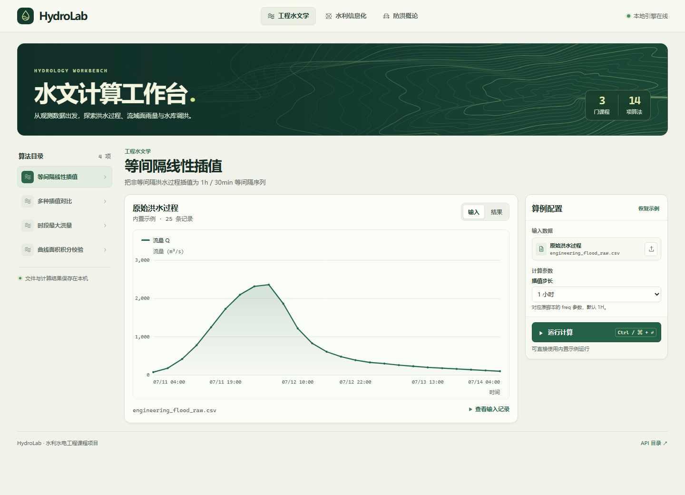
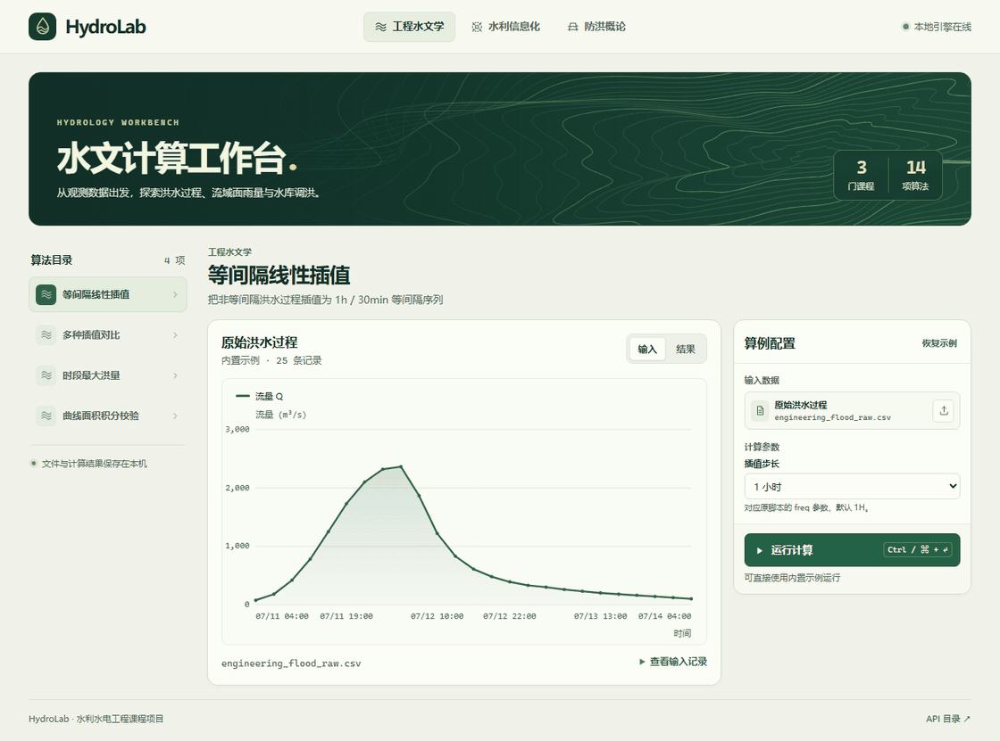
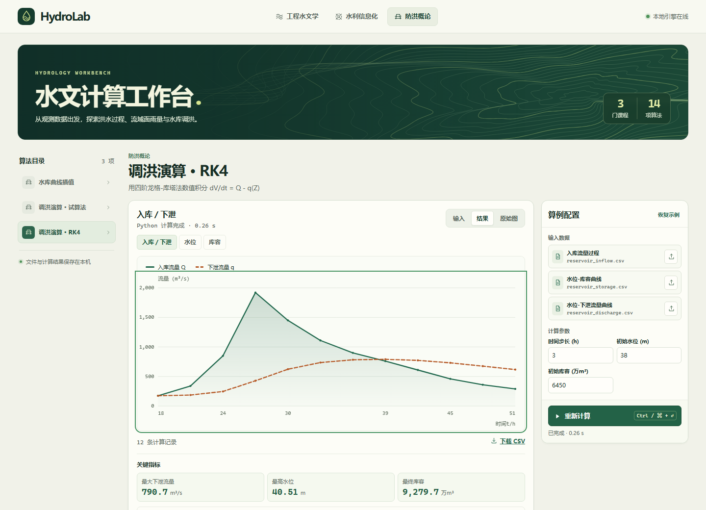
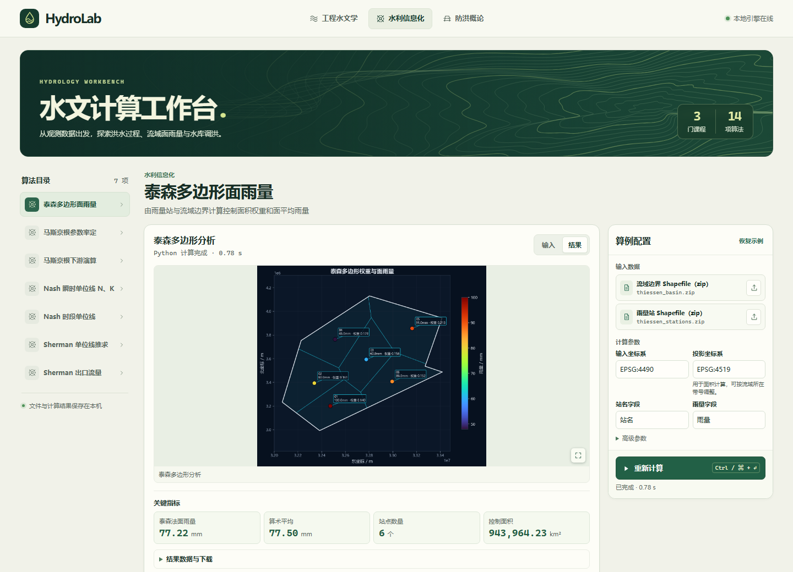
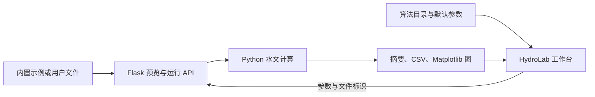

# HydroLab · 水文计算工作台

[English](README.en.md) · [快速启动](#快速启动) · [实现方式](#实现方式) · [MIT 许可证](LICENSE)

HydroLab 把水利水电工程课程中的洪水过程分析、流域面雨量估算和水库调洪做成一个本地工作台。选一个算法即可查看内置数据，调整参数后得到可交互的图表和完整 CSV。



## 实际操作

下方动图录自运行中的工作台。演示从洪水过程插值出发，切换到 RK4 调洪，查看入库／下泄过程与水位，最后打开完整结果的下载入口。



## 快速启动

建议使用 **Python 3.10–3.13**。首次安装依赖需要网络，后续在本地运行。前端由 Flask 直接提供。

| 系统 | 在仓库根目录执行 |
| --- | --- |
| Windows PowerShell | `.\start_workbench.bat`，也可双击该文件 |
| macOS / Linux | `bash start_workbench.sh` |

手动启动适合已有虚拟环境的用户。

```bash
python -m pip install -r requirements.txt
python workbench/start.py
```

启动后访问 [http://127.0.0.1:8765](http://127.0.0.1:8765)。终端按 `Ctrl+C` 停止，端口被占用时使用 `python workbench/start.py --port 8766`。在无界面环境运行可加 `--no-browser`。

## 从数据到结果

1. 在顶部选择课程，再从算法目录选择一个算例。所有 14 项算法都可用内置示例运行。
2. 点击配置卡中的文件名或图表上方的输入切换项查看数据。可上传或拖入自己的 CSV，泰森多边形使用流域边界和雨量站的 Shapefile ZIP。
3. 修改参数并点击 **运行计算**，或按 `Ctrl/⌘ + Enter`。图例可开关曲线，光标悬停或用方向键可查看数据点。
4. 在 **原始图** 查看 Python 生成的完整分析图，在 **结果数据与下载** 核对记录或下载 CSV。输入与输出的表格预览最多显示六行，便于快速核对字段。

| 课程 | 计算方法 |
| --- | --- |
| 工程水文学 | 线性等间隔插值、多方法插值对比、时段最大洪量、曲线面积积分校验 |
| 水利信息化 | 泰森多边形面雨量、马斯京根 X/K 率定与下游演算、Nash 瞬时单位线与时段单位线、Sherman 单位线推求与出口流量 |
| 防洪概论 | 水库曲线插值、试算法调洪、四阶龙格–库塔（RK4）调洪 |

<details>
<summary>查看 RK4 调洪和泰森多边形截图</summary>





</details>

## 实现方式

目录驱动的前端从 Flask 读取算法、表单、参数默认值和示例文件。每次运行都会将参数与文件标识交给对应的 Python 计算器，再读取同一算例的摘要、CSV 和 Matplotlib 图。浏览器用 Canvas 绘制过程线和洪量对比，并把单位不同的调洪变量放在独立视图中。空间分析使用 GeoPandas、Shapely 和 SciPy，泰森多边形地图直接展示 Python 生成的原图。



输入曲线使用 API 返回的预览数据，有截断时会标明。结果曲线优先读取完整结果 CSV，可下载的数据始终来自该次 Python 计算。浏览器中的图表负责呈现，原始课程脚本和工作台计算器执行数值计算。

旧版插值 CSV 的时间字段精确到小时。选择 30 分钟步长时，交互图按记录顺序展示，精确时间可在原始计算图中查看。

### 工程结构

```text
.
├── workbench/
│   ├── static/                  # 页面、样式、工作区交互与 Canvas 图表
│   ├── app.py                   # Flask API、文件预览及算法调度
│   ├── catalog.py               # 课程、算法、参数与示例配置
│   ├── common.py                # 读写数据、绘图主题、结果管理
│   ├── engineering.py           # 插值与洪量积分
│   ├── muskingum.py             # 马斯京根率定与演算
│   ├── unit_hydrograph.py        # Nash 与 Sherman 单位线
│   ├── flood.py                  # 水库曲线插值与调洪
│   ├── thiessen.py               # 泰森多边形与面雨量
│   ├── samples/                 # 可直接运行的示例
│   └── runtime/                 # 本地上传文件与运行产物，Git 忽略
├── 工程水文课程-代码开发/
├── 水利信息化课程-代码开发/
├── 防洪概论课程-代码开发/
└── docs/portfolio/               # 实际界面截图和动图
```

三个课程目录保留独立脚本和配套资料。单独运行课堂脚本前，请检查其中的本机文件路径、字体和单位约定。上传文件可参照工作台同算法的 [内置示例](workbench/samples/)。

## 开发与部署

- [维护、接口与验收指南](Agent.md)
- [可交给 AI Agent 的一键部署提示词](一键启动部署提示词.md)

**张德海（ZDH）** · 四川农业大学水利水电工程专业。本项目始于大二、大三的课程实验与作业，使用 [MIT 许可证](LICENSE)。
